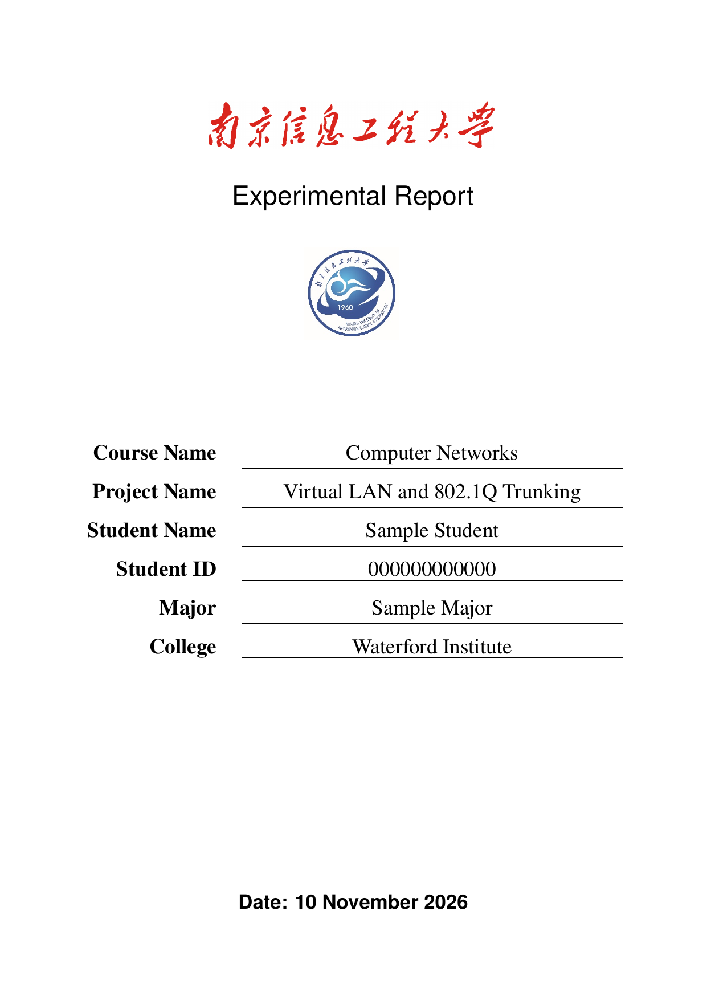

# NUIST Lab Report Agent Skill

<p align="center">
  <a href="#english">English</a> ·
  <a href="#zh-cn">简体中文</a> ·
  <a href="#harness-support">Harness support</a> ·
  <a href="HARNESSES.md">Install paths</a> ·
  <a href="#installation">Install</a> ·
  <a href="#privacy">Privacy</a> ·
  <a href="#中文安装与个人资料">中文安装</a>
</p>

<p align="center">
  
  
  
  
</p>

A portable Agent Skill for producing consistent course laboratory reports with LaTeX, evidence-first structure, automated PDF checks, and per-user installation. It is designed for Codex, Claude Code, OpenCode, Hermes, Pi, Oh My Pi, DSH, ZCode, and WorkBuddy.



---

<a id="english"></a>

## English

### Why this repository

Most report templates stop at a copied `.tex` file. This repository packages the whole workflow:

- a real `labreport.sty` and cover template;
- a portable `SKILL.md` that follows the Agent Skills layout;
- an installer that personalizes the skill for each user;
- evidence placement rules and a report contract;
- report scaffolding, compilation, pending-marker checks, missing-figure checks, layout checks, and per-page rendering.

### What is included

| Component | Purpose |
|---|---|
| `SKILL.md` | Harness-neutral Agent Skill instructions |
| `assets/latex/lab-report/labreport.sty` | Cover, headers, typography, tables, code listings, and evidence figures |
| `assets/latex/lab-report/main-template.tex` | Starter report with a standard section structure |
| `scripts/new-lab-report.ps1` | Creates a report directory and compiler wrapper |
| `scripts/compile-report.ps1` | Compiles, validates, and renders the final PDF |
| `references/report-contract.md` | Evidence hierarchy and report acceptance rules |
| `install.ps1` | Selects a harness, asks for personal fields, and installs a personalized copy |

### Harness support

<a id="harness-support"></a>

The shared unit is always a directory containing `SKILL.md` plus optional `scripts/`, `references/`, and `assets/`.

| Harness | Native user-level directory |
|---|---|
| Codex / universal `.agents` | `~/.agents/skills/lab-report/` |
| Claude Code | `~/.claude/skills/lab-report/` |
| OpenCode | `~/.config/opencode/skills/lab-report/` |
| Hermes | `~/.hermes/skills/lab-report/` |
| Pi | `~/.pi/agent/skills/lab-report/` |
| Oh My Pi | `~/.omp/agent/skills/lab-report/` |
| DSH | `~/.dsh/skills/lab-report/` |
| ZCode | `~/.zcode/skills/lab-report/` |
| WorkBuddy | `~/.workbuddy/skills/lab-report/` |

Project-level alternatives and source links are documented in [HARNESSES.md](HARNESSES.md).

### Requirements

- A harness that supports Agent Skills or a compatible `SKILL.md` directory
- TeX Live with `latexmk`, `pdflatex`, `pdftoppm`, and `pdfinfo`
- PowerShell 7 or Windows PowerShell for the report scripts and installer

Check the LaTeX tools:

```powershell
latexmk -v
pdflatex -v
pdftoppm -v
pdfinfo -v
```

### Installation

<a id="installation"></a>

Clone the repository and run the interactive installer:

```powershell
git clone <YOUR_REPOSITORY_URL> NUIST-lab-report-skill
Set-Location NUIST-lab-report-skill
.\install.ps1
```

The installer first asks which harness or harnesses to install for, then asks for the per-user fields printed below the cover branding:

1. Student name
2. Student ID
3. Major
4. College
5. Optional university wordmark image
6. Optional university seal/logo image

`College` is a per-user cover field. It is prompted during installation and is never hardcoded in the shared repository.

Install one target explicitly:

```powershell
.\install.ps1 -Harness codex
.\install.ps1 -Harness claude-code
.\install.ps1 -Harness opencode
```

Install for multiple targets:

```powershell
.\install.ps1 -Harness codex,claude-code,opencode,workbuddy
```

Install for every supported harness:

```powershell
.\install.ps1 -Harness all
```

Preview the selected targets without writing anything:

```powershell
.\install.ps1 -Harness all -DryRun
```

Install into an arbitrary compatible skill root:

```powershell
.\install.ps1 -TargetPath "D:\custom-agent\skills\lab-report"
```

Existing installations are protected by a timestamped backup when `-Force` is used.

### Create a report

After installation, ask the selected harness to use `lab-report`, or invoke the installed scaffolding script directly:

```powershell
& "<installed-skill-root>/scripts/new-lab-report.ps1" `
  -ProjectRoot (Get-Location).Path `
  -Course "Computer Networks" `
  -LabNumber "2" `
  -Title "Virtual LAN and 802.1Q Trunking"
```

The installer has already stored Student Name, Student ID, Major, College, and logo paths in the local `personal-profile.json`. Course, lab number, title, and date remain report-specific.

The report scaffold contains only:

```text
reports/Lab2_Computer_Networks/
|-- main.tex
|-- figures/
|-- evidence/
|-- build/
|-- compile-report.ps1
|-- report.config.json
`-- README.md
```

No LaTeX template is copied into the project.

### Build and verify

Scaffold preview:

```powershell
.\compile-report.ps1 -AllowPending
```

Final build:

```powershell
.\compile-report.ps1
```

The final check rejects:

- unresolved `\LabPending{...}` markers;
- missing `\LabEvidenceFigure` files;
- Overfull or Underfull boxes;
- LaTeX compilation failures.

It then renders every PDF page to `build\pages` and reports the page count.

### Privacy

<a id="privacy"></a>

The shared repository contains the institutional NUIST wordmark and seal, but no individual student data.

Personal fields are written only to the installing user's local skill:

```text
<installed-skill-root>/personal-profile.json
```

The shared repository contains:

- no student name;
- no student ID;
- no personal email or Git identity;
- no local absolute paths;
- no personal profile file;
- no custom institution logo copied by the installer.

The repository-local Git identity is a neutral placeholder. Global Git settings are never changed by these scripts.

### Repository map

```text
NUIST-lab-report-skill/
|-- SKILL.md
|-- HARNESSES.md
|-- install.ps1
|-- profile.example.json
|-- README.md
|-- LICENSE
|-- CHANGELOG.md
|-- agents/
|   `-- openai.yaml
|-- assets/
|   `-- latex/
|       `-- lab-report/
|           |-- labreport.sty
|           |-- main-template.tex
|           |-- README.md
|           `-- assets/
|-- docs/
|   `-- preview-cover.png
|-- references/
|   `-- report-contract.md
`-- scripts/
    |-- new-lab-report.ps1
    `-- compile-report.ps1
```

### License

MIT. See [LICENSE](LICENSE).

---

<a id="zh-cn"></a>

## 简体中文

### 这个仓库解决什么问题

绝大多数实验报告模板只提供一个复制出来的 `.tex` 文件。这个仓库把完整流程一起打包：

- 实际的 `labreport.sty` 和封面模板；
- 符合 Agent Skills 目录规范的 `SKILL.md`；
- 安装时按用户写入个人资料的安装器；
- 证据目录规范与报告验收契约；
- 自动建报告、编译、待填项检查、缺图检查、版面检查和逐页渲染。

### 仓库内容

| 组件 | 用途 |
|---|---|
| `SKILL.md` | 与 Harness 无关的 Agent Skill 指令 |
| `assets/latex/lab-report/labreport.sty` | 封面、页眉、字体、表格、代码块和证据图 |
| `assets/latex/lab-report/main-template.tex` | 标准章节结构的报告起始文件 |
| `scripts/new-lab-report.ps1` | 创建报告目录和本地编译入口 |
| `scripts/compile-report.ps1` | 编译、检查并渲染最终 PDF |
| `references/report-contract.md` | 证据层级和报告验收规则 |
| `install.ps1` | 选择 Harness、询问个人字段并安装个性化副本 |

### 支持的 Harness

共享核心始终是一个包含 `SKILL.md` 的目录，并可携带 `scripts/`、`references/` 和 `assets/`。

| Harness | 原生用户级目录 |
|---|---|
| Codex / 通用 `.agents` | `~/.agents/skills/lab-report/` |
| Claude Code | `~/.claude/skills/lab-report/` |
| OpenCode | `~/.config/opencode/skills/lab-report/` |
| Hermes | `~/.hermes/skills/lab-report/` |
| Pi | `~/.pi/agent/skills/lab-report/` |
| Oh My Pi | `~/.omp/agent/skills/lab-report/` |
| DSH | `~/.dsh/skills/lab-report/` |
| ZCode | `~/.zcode/skills/lab-report/` |
| WorkBuddy | `~/.workbuddy/skills/lab-report/` |

各 Harness 的项目级目录和来源链接见 [HARNESSES.md](HARNESSES.md)。

### 环境要求

- 支持 Agent Skills 或兼容 `SKILL.md` 目录的 Harness
- 已安装 TeX Live，并包含 `latexmk`、`pdflatex`、`pdftoppm` 和 `pdfinfo`
- PowerShell 7 或 Windows PowerShell

检查 LaTeX 工具：

```powershell
latexmk -v
pdflatex -v
pdftoppm -v
pdfinfo -v
```

### 安装与个人资料

<a id="中文安装与个人资料"></a>

克隆仓库后运行交互式安装器：

```powershell
git clone <YOUR_REPOSITORY_URL> NUIST-lab-report-skill
Set-Location NUIST-lab-report-skill
.\install.ps1
```

安装器先询问要安装到哪个或哪些 Harness，再询问封面下方需要个人化的字段：

1. Student name
2. Student ID
3. Major
4. College
5. 可选 university wordmark 图片
6. 可选 university seal/logo 图片

`College` 是每个用户不同的学院字段，只在安装时询问，共享仓库不会硬编码任何学院名称。

也可以直接指定单个 Harness：

```powershell
.\install.ps1 -Harness codex
.\install.ps1 -Harness claude-code
.\install.ps1 -Harness opencode
```

安装到多个 Harness：

```powershell
.\install.ps1 -Harness codex,claude-code,opencode,workbuddy
```

安装到全部支持的 Harness：

```powershell
.\install.ps1 -Harness all
```

只查看目标目录，不写入任何文件：

```powershell
.\install.ps1 -Harness all -DryRun
```

安装到任意兼容目录：

```powershell
.\install.ps1 -TargetPath "D:\custom-agent\skills\lab-report"
```

如果目标已存在，必须使用 `-Force`；旧版本会先被移动到带时间戳的备份目录。

### 创建实验报告

安装后在选定 Harness 中调用 `lab-report`，或直接运行安装后的脚手架：

```powershell
& "<installed-skill-root>/scripts/new-lab-report.ps1" `
  -ProjectRoot (Get-Location).Path `
  -Course "Computer Networks" `
  -LabNumber "2" `
  -Title "Virtual LAN and 802.1Q Trunking"
```

个人姓名、学号、专业、学院和 Logo 路径会从本地 `personal-profile.json` 自动加载。课程、实验编号、报告题目和日期仍然是每份报告单独填写。

生成的报告目录只包含：

```text
reports/Lab2_Computer_Networks/
|-- main.tex
|-- figures/
|-- evidence/
|-- build/
|-- compile-report.ps1
|-- report.config.json
`-- README.md
```

LaTeX 模板不会复制到项目目录。

### 编译与验收

脚手架预览：

```powershell
.\compile-report.ps1 -AllowPending
```

正式编译：

```powershell
.\compile-report.ps1
```

正式模式会拒绝：

- 未替换的 `\LabPending{...}`；
- 缺失的 `LabEvidenceFigure` 文件；
- Overfull 或 Underfull 版面；
- LaTeX 编译错误。

编译完成后会把每一页渲染到 `build\pages`，并报告 PDF 页数。

### 隐私与本地个人资料

<a id="隐私与本地个人资料"></a>

共享仓库保留 NUIST 校名艺术字和校徽，但不包含任何学生个人资料。

个人字段只写入安装者本机的 Skill 目录：

```text
<installed-skill-root>/personal-profile.json
```

共享仓库不包含：

- 学生姓名；
- 学号；
- 个人邮箱或 Git 身份；
- 本机绝对路径；
- `personal-profile.json`；
- 安装时复制的自定义校徽。

仓库的本地 Git 提交身份是中性占位身份，安装脚本不会修改用户的全局 Git 配置。

### 目录结构

```text
NUIST-lab-report-skill/
|-- SKILL.md
|-- HARNESSES.md
|-- install.ps1
|-- profile.example.json
|-- README.md
|-- LICENSE
|-- CHANGELOG.md
|-- agents/
|   `-- openai.yaml
|-- assets/
|   `-- latex/
|       `-- lab-report/
|           |-- labreport.sty
|           |-- main-template.tex
|           |-- README.md
|           `-- assets/
|-- docs/
|   `-- preview-cover.png
|-- references/
|   `-- report-contract.md
`-- scripts/
    |-- new-lab-report.ps1
    `-- compile-report.ps1
```

### 许可证

MIT，详见 [LICENSE](LICENSE)。

---

<p align="right"><a href="#nuist-lab-report-agent-skill">Back to top / 返回顶部</a></p>
